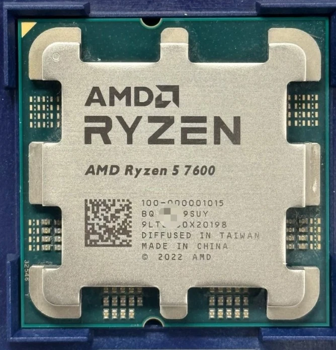
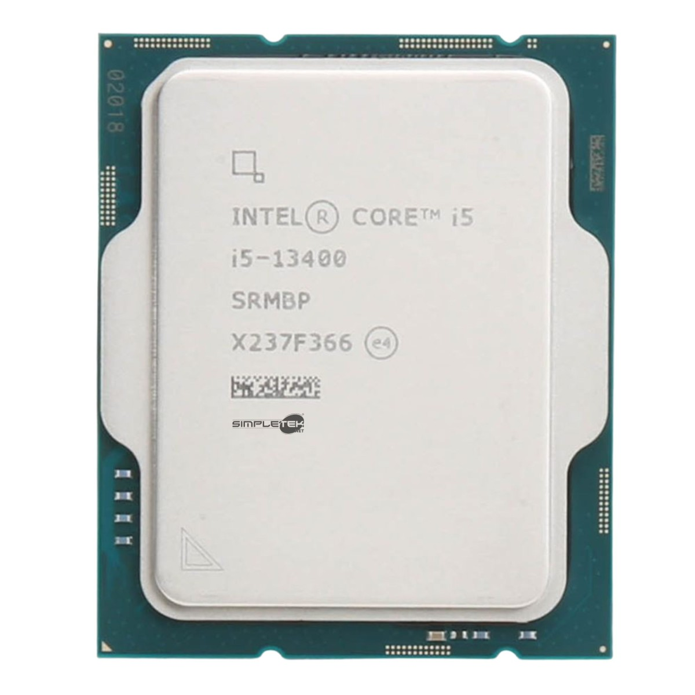
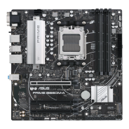
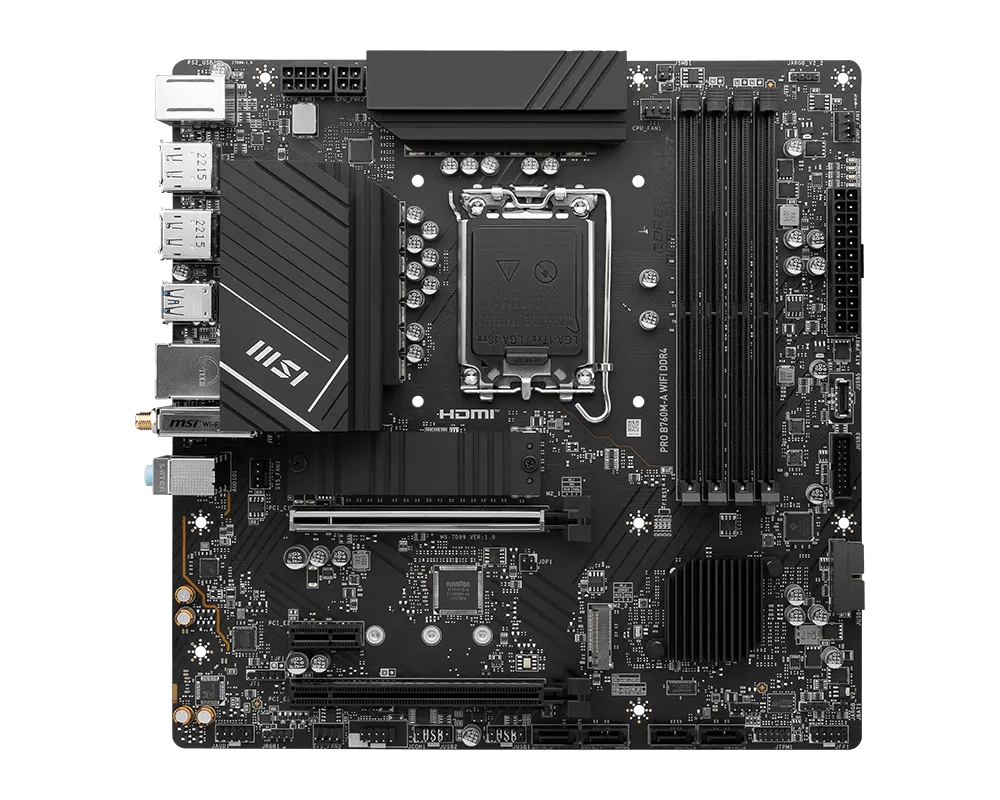
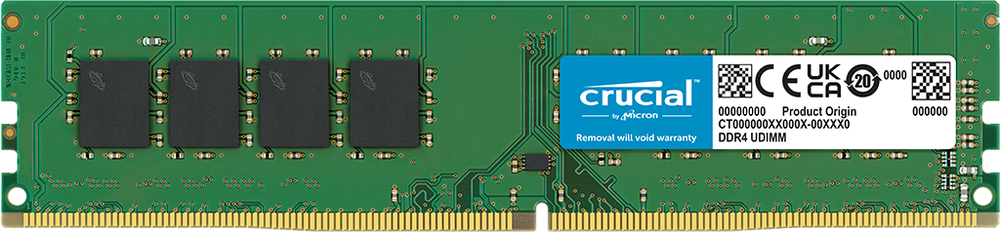
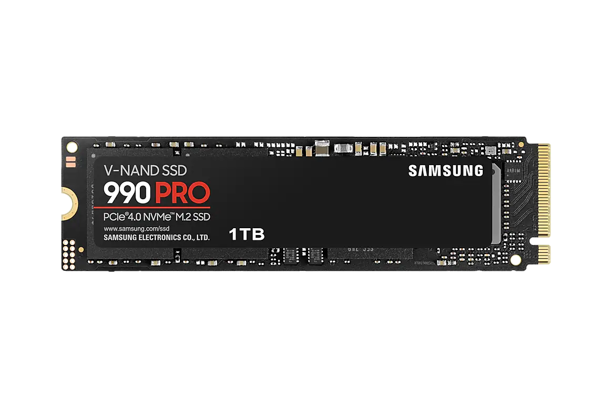
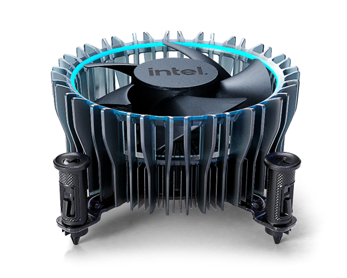

# Lab 3 — Teardown, and the same machine from the command line

## 1. Components 

### 1. AMD Ryzen 5 7600 — Processor

The Ryzen 5 7600 is a desktop CPU with 6 cores and 12 threads. It connects to an AM5 motherboard socket and uses DDR5 memory. Limit: It cannot fit an Intel LGA1700 board or a DDR4-only setup. The boxed version includes an AMD Wraith Stealth cooler and has built-in Radeon graphics.

Maker: [AMD — Ryzen 5 7600](https://www.amd.com/en/products/processors/desktops/ryzen/7000-series/amd-ryzen-5-7600.html)

### 2. Intel Core i5-13400 — Processor

The Core i5-13400 is a 13th-generation desktop CPU with 10 cores (6 performance and 4 efficient) and 16 threads. It connects to an LGA1700 motherboard socket. It supports DDR4-3200 or DDR5-4800, depending on the motherboard. Limit: It does not fit an AMD AM5 socket. It has Intel UHD 730 integrated graphics.

Maker: [Intel — Core i5-13400 specifications](https://www.intel.com/content/www/us/en/products/sku/230495/intel-core-i513400-processor-20m-cache-up-to-4-60-ghz/specifications.html)

### 3. ASUS PRIME B650M-A — Motherboard

This is a micro-ATX motherboard with an AMD B650 chipset, an AM5 CPU socket and four DDR5 DIMM slots. It connects the CPU, RAM, M.2 SSDs, SATA drives and power supply. Limit: It cannot accept LGA1700 CPUs or DDR4 RAM. ASUS lists Ryzen 7000, 8000 and 9000 desktop processors, with BIOS version requirements for some CPUs.

Maker: [ASUS — PRIME B650M-A technical specifications](https://www.asus.com/motherboards-components/motherboards/prime/prime-b650m-a/techspec/), [ASUS CPU support list](https://www.asus.com/motherboards-components/motherboards/prime/prime-b650m-a/helpdesk_qvl_cpu?model2Name=PRIME-B650M-A)

### 4. MSI PRO B760M-A WIFI DDR4 — Motherboard

This micro-ATX board has an Intel B760 chipset, an LGA1700 CPU socket and four DDR4 DIMM slots. It connects the processor, DDR4 RAM, M.2 and SATA drives, and power cables. Limit: It cannot use AM5 CPUs or DDR5 RAM. MSI lists Intel Core 12th-, 13th- and 14th-generation processors; some CPUs may require a suitable BIOS version.

Maker: [MSI — PRO B760M-A WIFI DDR4 specifications](https://www.msi.com/Motherboard/PRO-B760M-A-WIFI-DDR4/Specification), [MSI support/compatibility](https://www.msi.com/Motherboard/PRO-B760M-A-WIFI-DDR4/support)

### 5. Kingston FURY Beast DDR5-5600, 16 GB — Memory

This is one 16 GB DDR5-5600 desktop UDIMM, model KF556C40BB-16, with 288 pins. It plugs into a DDR5 DIMM slot on the motherboard. Limit: It cannot fit a DDR4 slot. Its 5600 MT/s speed uses an XMP profile; without a supported profile, it can run at its default DDR5-4800 speed. Running at 5600 MT/s is not guaranteed on every CPU/board combination.

Maker: [Kingston — KF556C40BB-16](https://www.kingston.com/en/memory/search?partid=KF556C40BB-16)

### 6. Crucial DDR4-3200, 16 GB DIMM — Memory

This is one 16 GB DDR4-3200 desktop UDIMM, model CT16G4DFRA32A, with 288 pins, CL22 timing and 1.2 V operation. It plugs into a DDR4 desktop motherboard DIMM slot. Limit: It cannot fit DDR5 slots or laptop SO-DIMM slots.

Maker: [Crucial — CT16G4DFRA32A](https://www.crucial.com/memory/ddr4/ct16g4dfra32a)

### 7. Samsung 990 PRO 1 TB — SSD

This is a 1 TB M.2 2280 NVMe SSD using PCIe 4.0 x4. It connects directly to an M.2 slot that supports PCIe/NVMe storage; no SATA cable is needed. Limit: It will not work through a SATA-only connection. It can work in a compatible PCIe 5.0 M.2 slot at PCIe 4.0 speed.

Maker: [Samsung — 990 PRO 1 TB](https://www.samsung.com/uk/memory-storage/nvme-ssd/990-pro-1tb-nvme-pcie-gen-4-mz-v9p1t0bw/)

### 8. Samsung 870 EVO 1 TB — SSD

This is a 1 TB 2.5-inch SATA SSD using a SATA 6 Gb/s interface. It connects to a motherboard SATA port with a SATA data cable and to the power supply with a SATA power connector. Limit: It cannot be installed in an M.2 slot, and SATA is slower than a PCIe 4.0 NVMe connection.

Maker: [Samsung — 870 EVO 1 TB](https://www.samsung.com/uk/business/memory-storage/sata-ssd/870-evo-sata-3-2-5-ssd-mz-77e1t0b-eu/)

### 9. Corsair RM750e 750 W — Power supply

This is a 750 W fully modular ATX power supply. Its cables connect to the motherboard's 24-pin ATX connector, CPU 8-pin power connector, and SATA-powered devices where needed. Limit: It needs an ATX-PSU-compatible case and cannot power two separate computers at once. Each complete build needs its own PSU.

Maker: [Corsair — RM750e 750 W](https://www.corsair.com/us/en/p/psu/cp-9020295-na/rme-series-rm750e-fully-modular-low-noise-atx-power-supply-cp-9020295-na)

### 10. Intel Laminar RM1 — Stock CPU cooler

This is the stock air cooler included with the boxed Intel Core i5-13400. It mounts above an LGA1700 processor and its fan connects to the motherboard's CPU_FAN header. Limit: Its supplied mounting system is for LGA1700, not AMD AM5. The boxed AMD Ryzen 5 7600 instead includes the AMD Wraith Stealth cooler for its AM5 build.

Maker: [Intel — Laminar RM1 cooler and boxed CPU list](https://www.intel.com/content/www/us/en/support/articles/000089190/processors/intel-core-processors.html)

## 2. Motherboard CPU and memory compatibility

| Motherboard | Socket | Chipset | RAM type | Supported CPU generations |
|---|---|---|---|---|
| ASUS PRIME B650M-A | AMD AM5 | AMD B650 | DDR5 desktop DIMM | AMD Ryzen 7000 Zen 4, 8000 Zen 4 and 9000 Zen 5, desktop processors |
| MSI PRO B760M-A WIFI DDR4 | Intel LGA1700 | Intel B760 | DDR4 desktop DIMM | Intel Core 12th,13th and 14th Gen |

The Ryzen 5 7600 belongs on the ASUS AM5/DDR5 board. The i5-13400 belongs on the MSI LGA1700/DDR4 board. DDR4 and DDR5 are not interchangeable.

## 3. Two compatible computer builds

### Build 1

| Part | Choice | Why it fits |
|---|---|---|
| CPU | AMD Ryzen 5 7600 | the ASUS board supports Ryzen 7000 processors on AM5 |
| Motherboard | ASUS PRIME B650M-A | its AM5 socket and DDR5 slots match the CPU and RAM. |
| RAM | Kingston FURY Beast DDR5-5600, 16 GB | DDR5 desktop UDIMM fits the board's DDR5 slots. It may run at a lower/default speed |
| Storage | Samsung 990 PRO 1 TB | its M.2 2280 PCIe 4.0 NVMe interface works in the board's M.2 PCIe slot |
| Power | Corsair RM750e 750 W | provides the ATX and CPU power cables and more than enough power without a discrete GPU |
| Cooling | AMD Wraith Stealth | made for the boxed Ryzen processor and attaches to the CPU_FAN header |

**Still needed:** a case that fits a micro-ATX motherboard and an ATX PSU, and display, keyboard and mouse. Normal case fans also needed for airflow

### Build 2

| Part | Choice | Why it fits |
|---|---|---|
| CPU | Intel Core i5-13400 | 13th-generation LGA1700 CPU supported by the MSI B760 board |
| Motherboard | MSI PRO B760M-A WIFI DDR4 | LGA1700 socket and DDR4 slots match the chosen processor and memory |
| RAM | Crucial DDR4-3200, 16 GB | desktop DIMM fits the motherboard and matches Intel's supported DDR4 speed |
| Storage | Samsung 870 EVO 1 TB | it connects to one of the board's SATA 6 Gb/s ports |
| Power | Corsair RM750e 750 W | provides the ATX/CPU power and SATA power for this separate computer |
| Cooling | Intel Laminar RM1 | its LGA1700 mount matches the CPU and motherboard |

**Still needed:** SATA data cable, case fans, an operating system, also display, keyboard and mouse.

## 4. CPU, memory and disk facts

| Fact | Windows  | Linux  | macOS  |
|---|---|---|---|
| CPU model and number of cores | Get-CimInstance Win32_Processor | lscpu | system_profiler SPHardwareDataType |
| Total memory | Get-CimInstance Win32_ComputerSystem | free -h | system_profiler SPHardwareDataType |
| Disk model and capacity | Get-CimInstance Win32_DiskDrive | lsblk -d -o NAME,MODEL,SIZE,TYPE | diskutil info disk0 |

Windows on a physical windows PC, Ubuntu server inside a VMware virtual machine on a mac and macOS on a physical mac. The Linux results describe the virtual machine, not the Macs physical hardware

**Raw command output files:**
- [`evidence/windows-specs.txt`](evidence/windows-specs.txt) — on Windows
- [`evidence/linux-specs.txt`](evidence/linux-specs.txt) — the ubuntu VM
- [`evidence/macos-specs.txt`](evidence/macos-specs.txt) — on macOS
