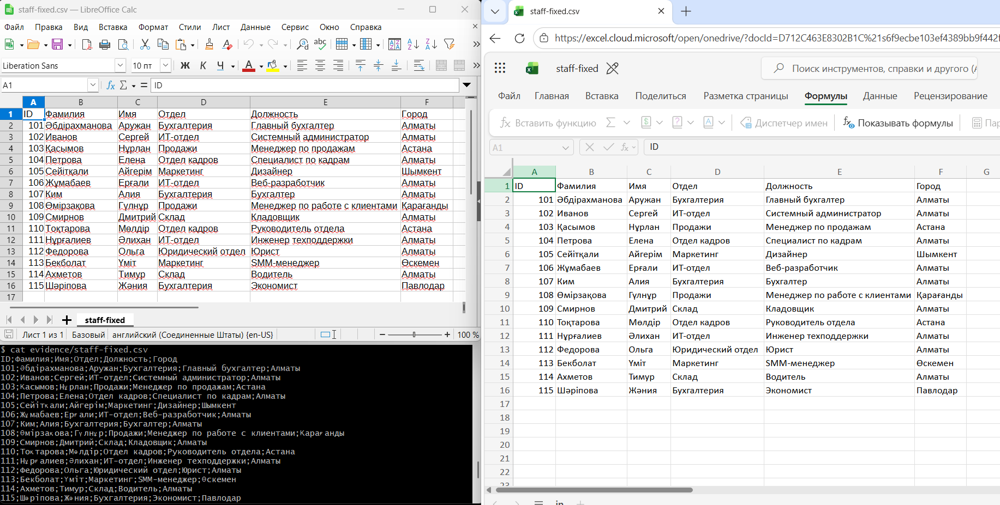

# Lab 5 — Encoding forensics
Name: Adiyana · Date: 17.11.2026  · Tools: Git Bash 

## What I received

Excel: Kazakh letters were displayed incorrectly but the columns were separated correctly
LibreOffice: Kazakh letters displayed as incorrect characters but the columns were separated correctly
Terminal: Kazakh letters were incorrect but the CSV content was displayed

## Diagnosis (made before the fix)
- file said: Non-ISO extended-ASCII text, with CRLF line terminators [hexdump-before.txt](evidence/file-before.txt)
- First 16 bytes: 4944 3bd4 e0ec e8eb e8ff 3bc8 ecff 3bce [hexdump-before.txt](evidence/hexdump-before.txt)
- Encoding: RK1048 - because the byte a3 represents Ә in RK1048 and RK1048 displayed the Kazakh names correctly
- Line ending: CRLF - because the hex dump shows 0D 0A at the end of the CSV lines
- BOM: no - because file starts with 49 44 3b. in the fixed file I added a UTF-8 BOM because it helps excel on windows recognize UTF-8 when opening the CSV directly

## Fix
```bash
#!/bin/sh
in=evidence/staff-broken.csv
out=evidence/staff-fixed.csv

iconv -f RK1048 -t UTF-8 "$in" > "$out"

printf '\357\273\277' | cat - "$out" > "$out.tmp"
mv "$out.tmp" "$out"
```

## Verification
the fixed file uses UTF-8 with BOM and CRLF line endings. It opened correctly in excel, libreOffice and git bash [file-after.txt](evidence/file-after.txt);



## What did not work the first time
I ran the file command in powershell using git bash syntax. It didnt save the command output correctly, then I opened git bash and ran the command again and the result was saved correctly. I also tested windows 1251 but some kazakh letters were incorrect. Using RK1048 displayed them correctly
