# BUILD.md — Linux and Windows Test Machines

This guide explains how to create two test virtual machines from scratch:

- `ubuntu01` — Ubuntu Server on an Apple Silicon Mac using VMware Fusion.
- `windows01` — Windows 11 on a Windows PC using VMware Workstation Pro.

Connect both physical computers to the same local network. Both guests will use **Bridged** networking so they can communicate across the two hosts. Run Linux commands inside `ubuntu01` and PowerShell commands inside `windows01`.


## Step 1. Prepare the hosts and installation files

Prepare the following:
- An Apple Silicon Mac with VMware Fusion and an Ubuntu Server 26.04.1 LTS ARM64 ISO.
- A Windows PC with VMware Workstation Pro and a Windows 11 Enterprise Evaluation x64 ISO.
- Enough available host memory and storage for the allocations below, with additional space for installation files and snapshots.
- A connection from both hosts to the same local network.

| VM | Memory | vCPUs | Virtual disk |
| --- | --- | --- | --- |
| `ubuntu01` | 4096 MB in VMware settings | 2 | 25 GiB |
| `windows01` | 4096 MB in VMware settings | 2 | 64 GB |

On the Mac, select **File → New → Install from disc or image** in Fusion. On the PC, select **File → New Virtual Machine → Typical (recommended)** in Workstation Pro.

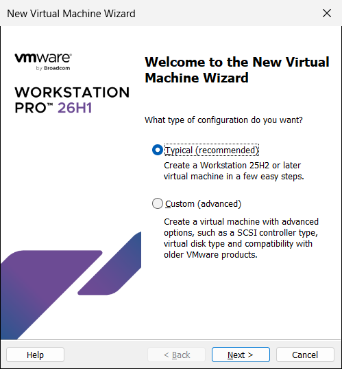

The Ubuntu ARM64 image matches the Apple Silicon Mac, while the Windows x64 image is used on the PC. The standard creation wizards provide the settings needed for this build without requiring a custom configuration.

> Check: both creation wizards open, both ISO files are available, and each host has enough available memory and storage for its guest

## Step 2. Create the Ubuntu virtual machine

In Fusion, select the Ubuntu Server ARM64 ISO. If the operating system is not detected automatically, choose **Linux → Ubuntu 64-bit Arm**. Name the VM `ubuntu01` and save it in a local folder of your choice on the Mac

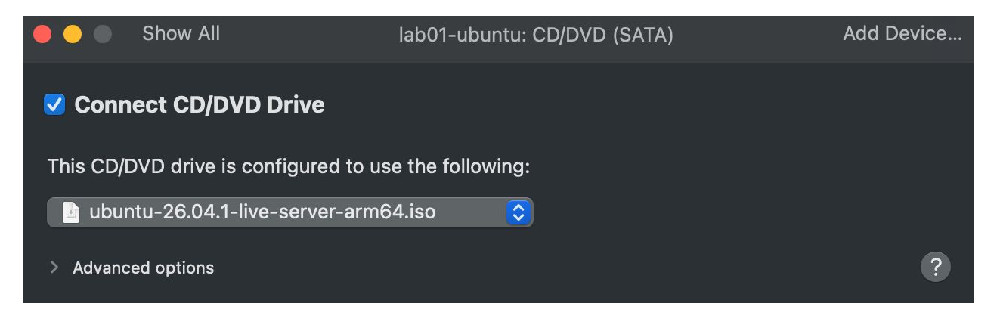

The ARM guest profile matches the installation image and the Mac's processor architecture. An x64 guest profile would not match this ARM64 build

> Check: the VM is named `ubuntu01`, and its guest type is Ubuntu 64-bit Arm

## Step 3. Configure Ubuntu memory, processors and disk

Open the settings for `ubuntu01`. Under **Processors & Memory**, set **4096 MB** of memory and **2 vCPUs**. Under **Hard Disk**, configure a **25 GiB NVMe virtual disk** 

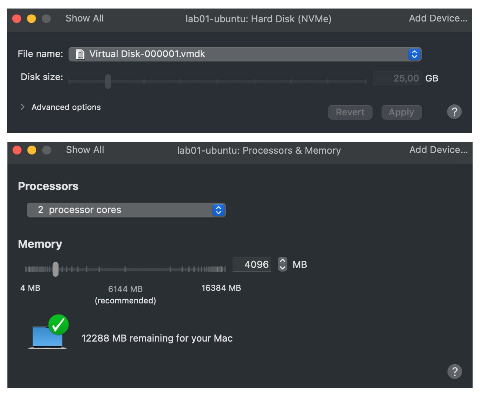

Four GiB of memory and two vCPUs provide resources for a basic server while leaving capacity for macOS. A growable disk uses host storage as data is added instead of reserving the entire disk immediately

> Check: Fusion shows 4096 MB of memory, 2 vCPUs and a 25 GiB NVMe disk

## Step 4. Configure the Ubuntu network

In Fusion open **Virtual Machine → Settings → Network Adapter**. Select **Bridged Networking → Autodetect** and enable **Connect Network Adapter**. If Autodetect selects the wrong host adapter, choose the Mac's active WiFi or Ethernet adapter explicitly

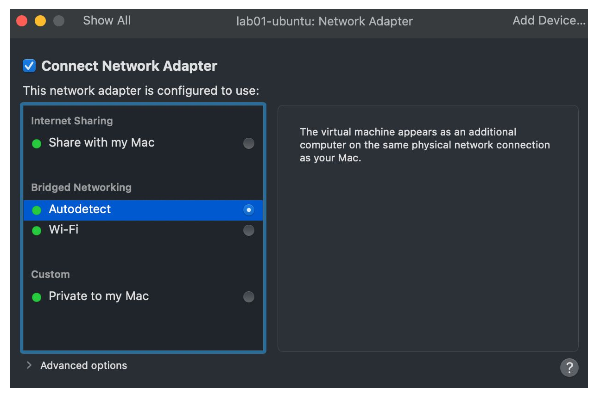

Bridged networking places Ubuntu on the physical LAN so it can reach the windows guest on the separate PC. NAT on each host would normally put the guests on separate private networks and require extra configuration for direct communication

> Check: the adapter is connected and Bridged is selected. its IP address will be checked after Ubuntu is installed

## Step 5. Install Ubuntu Server

Start `ubuntu01` with the Ubuntu Server ISO connected. In the installer:

1. Choose **English** and the keyboard layout you need.
2. Keep the network adapter on **DHCP**, leave the proxy blank unless required, and use the default archive mirror.
3. Choose **Use an entire disk**, select the **25 GiB virtual disk**, and disable LVM for this simple disk layout.
4. Set the server hostname to `ubuntu01` and the username to `"your_name"`. Create a private password
5. Review the storage changes, confirm installation and wait for it to finish.
6. Restart the VM, disconnect the installation ISO and log in to the installed system. 

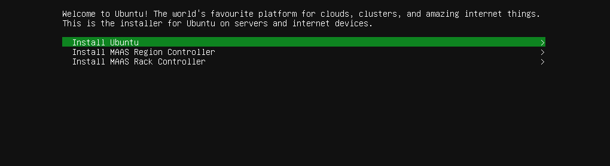

Using the whole dedicated virtual disk without LVM keeps the storage layout simpler than manual partitioning or volume management

> Check: Ubuntu boots from its virtual disk and accepts a login as `"your_name"` on `ubuntu01`.


## Step 6. Install VMware tools in Ubuntu

In Ubuntu, install the guest tools:

```bash
sudo apt update
sudo apt install -y open-vm-tools
```

Then check the service:

```bash
systemctl is-active open-vm-tools
```

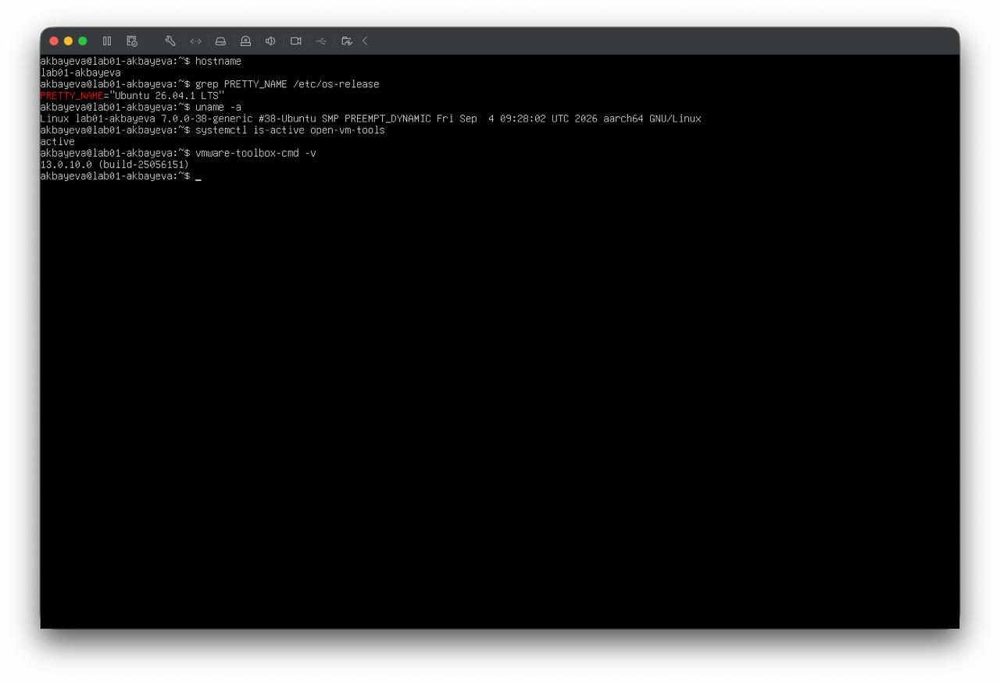

The `open-vm-tools` package provides VMware guest integration through Ubuntu's package manager. It avoids a separate manual tools installation for this server guest.

> Check: `systemctl is-active open-vm-tools` returns `active`.

## Step 7. Create the Windows virtual machine

On the PC, select **File → New Virtual Machine → Typical (recommended)** in Workstation Pro. Select the Windows 11 Enterprise Evaluation x64 ISO and choose **Microsoft Windows → Windows 11 x64** if prompted. Name the VM `windows01` and save it in a local folder of your choice on the PC.

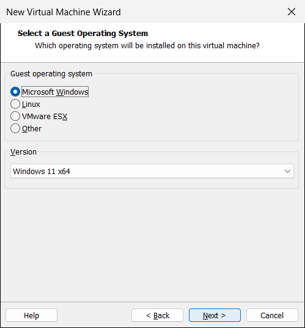

The Windows 11 x64 profile matches the installation image and provides the appropriate guest hardware defaults. An ARM profile would not match the x64 image used on this PC.

> Check: Workstation shows the VM name `windows01` and the Windows 11 x64 guest type.

## Step 8. Configure Windows hardware

Before installation open **Edit virtual machine settings** and configure:

- **Memory:** 4096 MB.
- **Processors:** 2 total vCPUs.
- **Virtual disk:** 64 GB.
- **Network Adapter:** Bridged, with **Connect at power on** enabled. use the PC's active network adapter.
- **Firmware:** UEFI, with Secure Boot enabled.
- **Trusted Platform Module:** enabled.
- **CD/DVD:** the Windows ISO, with **Connect at power on** enabled.

If Workstation requires encryption before adding the virtual TPM, select the option to encrypt only the files needed to support TPM and create a private encryption password

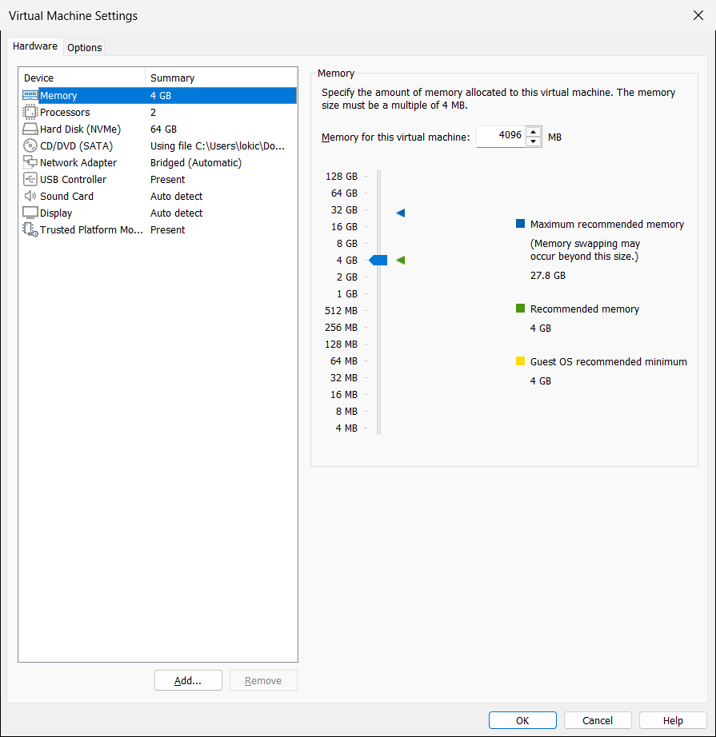

The memory, CPU and disk allocations provide the intended Windows test environment while leaving resources for the host; UEFI, Secure Boot and vTPM support the Windows 11 setup. Bridged networking lets Windows communicate with Ubuntu across the two hosts without extra NAT forwarding.

> Check: the hardware summary shows 4096 MB RAM, 2 total vCPUs, a 64 GB disk, a connected Bridged adapter, the installation ISO, UEFI, Secure Boot and a virtual TPM.

## Step 9. Install Windows 11

Start `windows01` and press a key when **Press any key to boot from CD or DVD** appears. In the installer:

1. Select the required language and keyboard, then start installation.
2. Select Windows 11 Enterprise if the evaluation image offers an edition choice, and accept the licence terms.
3. Choose **Custom: Install Windows only** if shown, select the **64 GB virtual disk**, and continue.
4. Allow the restarts; after the first restart, do not press a key to boot from the ISO again.
5. Complete the region, keyboard and account setup. Use `your_name` where a local username is required.
6. Set the device name to `windows01` if prompted. Otherwise, use **Settings → System → About → Rename this PC**, enter `windows01`, and restart.
7. Disconnect the installation ISO and clear its **Connect at power on** setting. Keep account credentials out of screenshots.

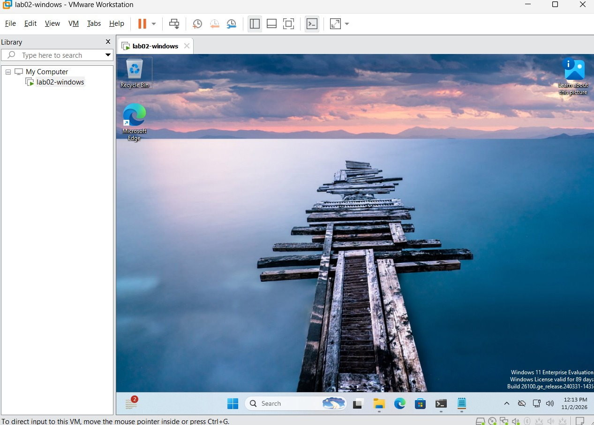

A custom installation puts Windows on the new virtual disk instead of attempting an upgrade. Disconnecting the ISO after setup prevents later boots from returning to the installer.

> Check: Windows reaches the signed-in desktop, and `hostname` in PowerShell returns `windows01`.

## Step 10. Install VMware Tools and check Windows

Select **VM → Install VMware Tools** in Workstation. Inside Windows, open the VMware Tools virtual DVD, run the installer, choose **Typical**, and restart when requested. Open PowerShell in the guest and run:

```powershell
hostname
Get-CimInstance Win32_OperatingSystem | Select-Object Caption,Version,BuildNumber
Get-CimInstance Win32_ComputerSystem | Select-Object TotalPhysicalMemory,NumberOfLogicalProcessors
Get-Volume -DriveLetter C | Select-Object DriveLetter,Size,SizeRemaining
Get-Service VMTools
```

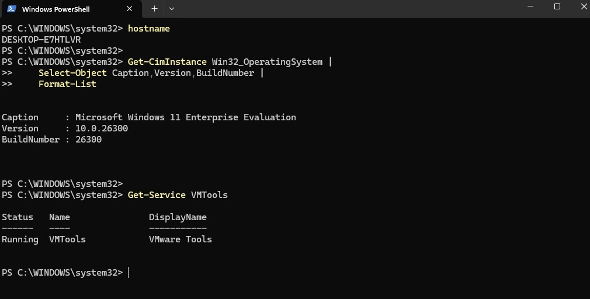

The Typical tools installation supplies the standard VMware guest drivers and integration features without selecting components individually. PowerShell checks the running guest instead of assuming that the ISO name and hardware settings prove installation succeeded

> check: the output identifies Windows 11 enterprise Evaluation, shows 2 logical processors and memory consistent with 4096 MB, and reports the `VMTools` service as `Running`

## Step 11. Find the IP addresses of both guests

Keep both VMs running, make sure that both adapters connected in Bridged mode, and both physical hosts on the same local network. In Ubuntu, run:

```bash
ip addr
ip route
```

In Windows PowerShell, run:

```powershell
ipconfig /all
```

Record each guest's active adapter IPv4 address, subnet mask or prefix, and default gateway. Use these current guest addresses in the following tests.

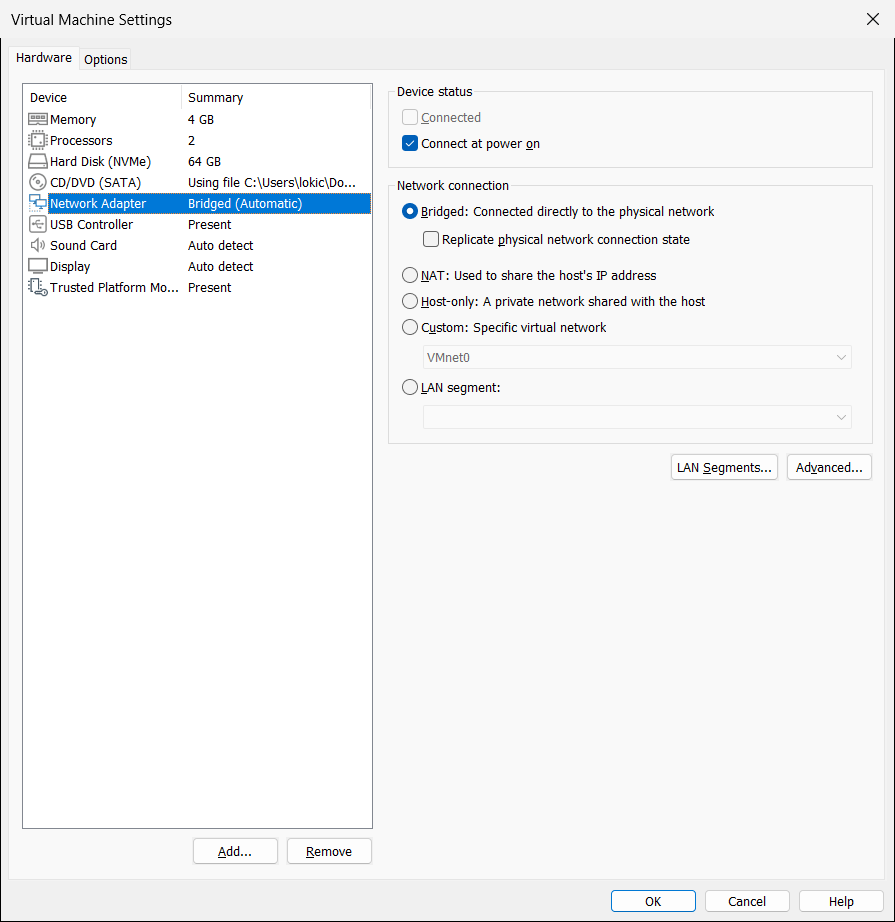

DHCP addresses can change, so reading them from the guests avoids using an outdated address or a host address. The guests need distinct addresses on the same reachable LAN for the direct tests in this build.

> Check: both active adapters have different IPv4 addresses in the same LAN subnet and a default gateway; an address starting with `169.254` indicates that DHCP did not supply a usable LAN address

## Step 12. Test communication between the two guests

Use the current IPv4 addresses recorded in Step 11. In Windows PowerShell, enter Ubuntu's address and run:

```powershell
ping -n 4 $linuxIP
```

In Ubuntu, enter Windows' address and run:

```bash
ping -c 4 "$WINDOWS_IP"
```

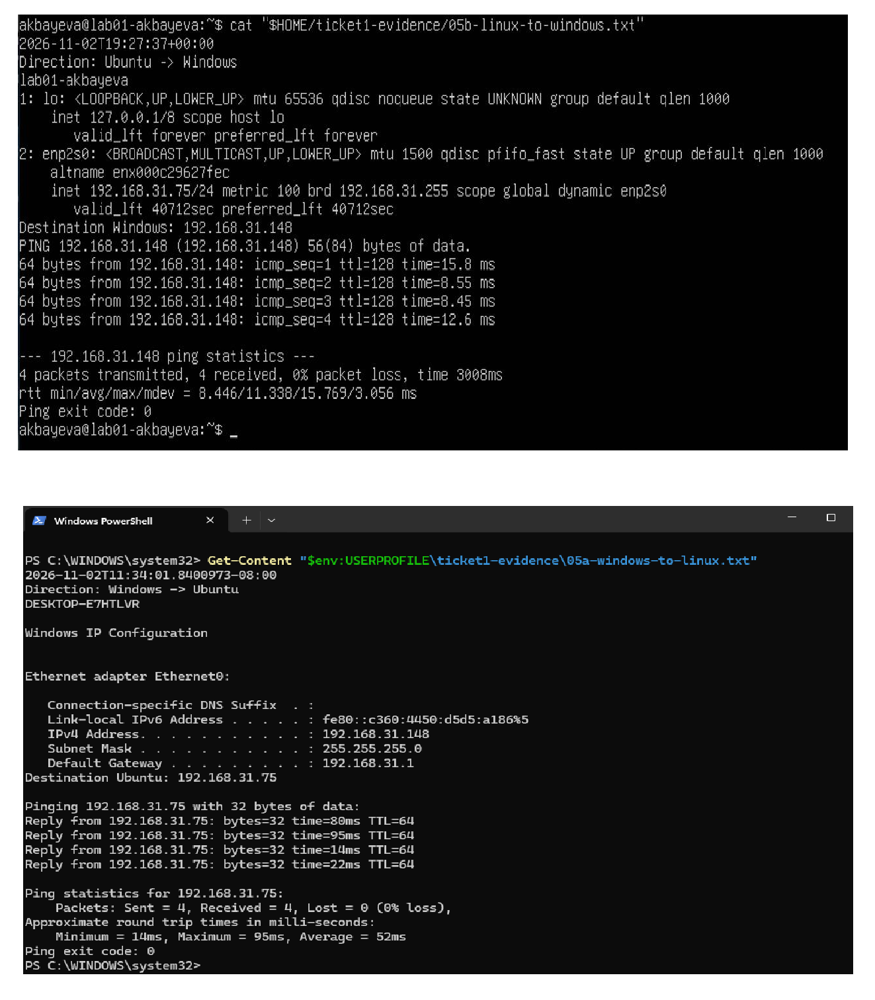

Testing both directions confirms that each guest can receive as well as send traffic across the two hosts. A successful test in only one direction could miss an inbound firewall problem.

> Check: each test receives four replies with 0% packet loss, and the text evidence includes both commands and their results.

## Step 13. Test internet access

In Ubuntu, run:

```bash
ping -c 4 ubuntu.com
```

In Windows PowerShell, run:

```powershell
ping ubuntu.com
```

If a test fails, review that guest's address, gateway and DNS settings using the Step 12 commands before repeating it. A remote server may block ping, so missing replies alone do not prove that all internet access is unavailable.

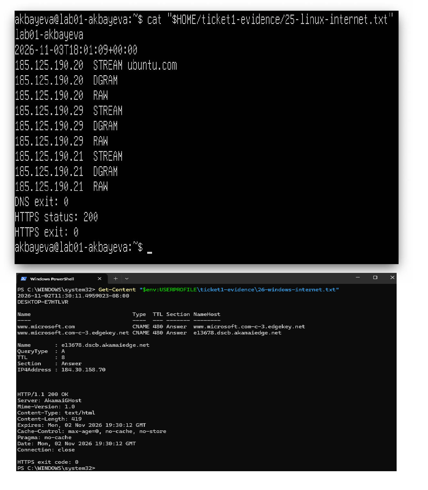

Using a domain name checks DNS resolution as well as external ICMP connectivity, unlike pinging a numeric address alone. Testing both guests separately can reveal a problem affecting only one VM.

> Check: both guests resolve `ubuntu.com` to an address and receive replies; unresolved names or missing replies require further investigation.

## Step 14. Create clean snapshots

After installation, guest tools and successful network tests, shut down both VMs normally. In Fusion, open **Virtual Machine → Snapshots** for `ubuntu01` and take a snapshot named `clean-install`. In Workstation, select **VM → Snapshot → Take Snapshot** for `windows01` and use the same name. Open both snapshot lists and capture them together in `evidence/06-snapshot-list.png`.

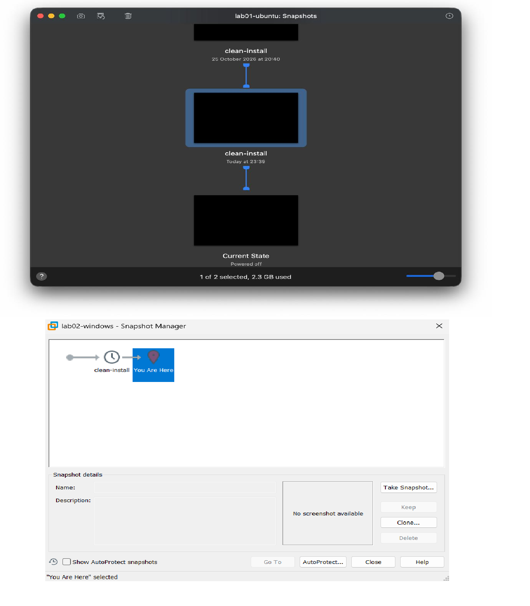

A powered-off snapshot gives each VM a recovery point before later changes without saving its running memory. It allows a return to the tested state instead of reinstalling the operating system.

> Check: each VM's snapshot list contains `clean-install`, taken after the successful build and tests.

## Final check

Before considering the build complete, confirm that:

- `ubuntu01` and `windows01` both boot and accept a login
- Both guests have the intended memory, CPU and disk settings.
- Both network adapters use Bridged networking and receive valid LAN addresses
- Ping succeeds in both directions and both guests pass the internet test.
- VMware guest tools are running in both guests
- Both VMs have a `clean-install` snapshot

